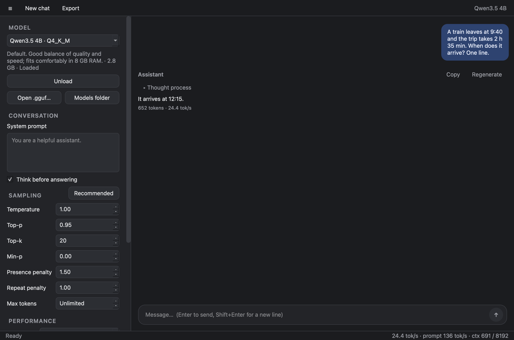
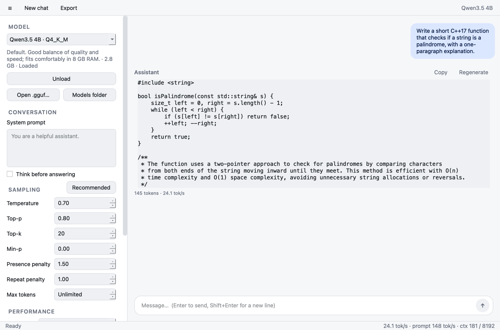

# QTllama

**Private, local LLM chat for the desktop, the terminal, and Android tablets.**
QTllama is a Qt 6 application built on [llama.cpp](https://github.com/ggml-org/llama.cpp).
It ships two front ends: a desktop/tablet GUI and a full-featured command line.
Both share one inference engine, and nothing leaves your machine.

The default model is **Qwen3.5 4B** (Q4_K_M, ~2.9 GB). Smaller and larger models
are one command away, and any other GGUF model works too.

<p align="center">
  
  
</p>

```text
$ qtllama-cli --no-think --stats "In one sentence, what is Qt?"
Qt is a comprehensive cross-platform application development framework ...
[prompt 20 tok @ 43.1 t/s | gen 40 tok @ 22.1 t/s | ctx 60/8192]
```

---

## Contents

- [Features](#features)
- [Supported platforms](#supported-platforms)
- [Quick start](#quick-start)
- [Using the CLI](#using-the-cli)
- [Using the GUI](#using-the-gui)
- [Models](#models)
- [Project layout](#project-layout)
- [Documentation](#documentation)
- [Performance reference](#performance-reference)
- [Contributing](#contributing)
- [License](#license)

## Features

**Shared engine (`core/`)**
- Runs llama.cpp in-process, linked statically; there's no server or Python runtime
- Streams tokens and handles UTF-8 that is split across tokens
- Separates the model's reasoning (`<think>…</think>`) from the answer, with thinking on/off per message
- Reuses the KV cache between turns, so follow-ups only process the new text
- Trims the oldest turns automatically when the context window fills
- Lists models from a JSON registry and auto-detects any `.gguf` files on disk
- Downloads from Hugging Face resumably, with no curl or Python needed

**GUI (`qtllama`)**
- Streams chat with rendered Markdown, including code blocks, tables and lists
- Shows live reasoning in a collapsible *Thought process* section
- Light, dark and system themes, plus an adjustable text size for tablets
- Downloads, loads and switches models from the sidebar while keeping the conversation
- Sampling, context, thread and GPU-offload settings, with a per-model **Recommended** reset
- Copy, Regenerate, Export to Markdown, keyboard shortcuts, and settings that persist

**CLI (`qtllama-cli`)**
- Interactive REPL with `/commands`, multi-line input, and Ctrl+C to stop a reply
- One-shot mode for scripts: `qtllama-cli "question"`, or pipe text in on stdin
- Every sampling and performance setting is available as a flag
- `--list` and `--download` to manage models; works over SSH and in Termux

## Supported platforms

| Platform | Status | Acceleration | Notes |
|---|---|---|---|
| macOS 13+ on Apple Silicon | ✅ Tested (M2, Homebrew Qt 6.5) | Metal | Primary development machine |
| Linux x86-64 / ARM64 | ✅ Supported | CPU (AVX/NEON); Vulkan or CUDA optional | Qt ≥ 6.2, e.g. Ubuntu 22.04+, Debian 12+ |
| Android via Termux | ✅ Tested (Samsung SM-X840, MediaTek MT6993, Qt 6.12) | CPU (ARMv9 dotprod/i8mm/SVE/SME) | GUI runs under Termux:X11 |

> Desktop Linux builds are expected to work but haven't been verified yet.
> On Termux, run the build script as `sh scripts/build_llama.sh` (Termux has no `/usr/bin/env`).
> See [docs/BUILDING.md](docs/BUILDING.md) for per-platform steps and known quirks.

## Quick start

```sh
# 1. Clone with the pinned llama.cpp submodule
git clone --recurse-submodules <repo-url> QTllama && cd QTllama

# 2. Build llama.cpp (once per machine; takes a few minutes)
scripts/build_llama.sh

# 3. Build both apps
mkdir build && cd build
qmake6 ../QTllama.pro          # use `qmake` if it is Qt 6 (e.g. Homebrew)
make -j8

# 4. Download the default model (~2.9 GB) and chat
./cli/qtllama-cli --download qwen3.5-4b
./cli/qtllama-cli
```

Start the GUI with `open gui/qtllama.app` on macOS or `./gui/qtllama` on Linux/Termux.
For a headless machine, build only the CLI: `qmake6 ../QTllama.pro CONFIG+=no_gui`.

## Using the CLI

```sh
qtllama-cli                                  # interactive chat with the default model
qtllama-cli "Explain move semantics"         # one-shot answer, then exit
git diff | qtllama-cli -p "Review this diff:" # stdin is appended to the prompt
qtllama-cli -m qwen3.5-2b --no-think         # smaller model, answer directly
qtllama-cli -m ~/Downloads/other.gguf -c 16384
qtllama-cli --list                           # registry + local files ([x] = downloaded)
```

| REPL command | Effect |
|---|---|
| `/help` | Show commands |
| `/reset` | Start a new conversation |
| `/system [text]` | Show or set the system prompt |
| `/think on\|off` | Toggle reasoning; also switches to that mode's recommended sampling |
| `/regen` | Regenerate the last reply |
| `/stats on\|off` | Print speed and context usage after each reply |
| `/save file.md` | Save the conversation as Markdown |
| `/info` | Show the model, context use and sampling settings |
| `/quit` | Exit (Ctrl+D also works) |

End a line with `\` to continue on the next line. All flags are listed in
**[docs/CLI.md](docs/CLI.md)**.

## Using the GUI

| Shortcut | Action |
|---|---|
| Enter / Shift+Enter | Send / new line |
| Esc | Stop generating |
| Ctrl+N | New chat |
| Ctrl+B | Show or hide the sidebar |

The sidebar holds the model, conversation (system prompt and thinking), sampling,
performance and appearance settings. If you type before a model is loaded, it
loads automatically and then sends. `qtllama "prompt"` sends a message on startup.
The full tour is in **[docs/GUI.md](docs/GUI.md)**.

## Models

| Id | Model | Size | Good for |
|---|---|---|---|
| `qwen3.5-4b` *(default)* | Qwen3.5 4B Q4_K_M | 2.9 GB | Balanced quality and speed; 8 GB RAM devices |
| `qwen3.5-2b` | Qwen3.5 2B Q4_K_M | 1.3 GB | Older CPUs, quick replies |
| `qwen3.5-0.8b` | Qwen3.5 0.8B Q4_K_M | 0.6 GB | Very low-end hardware, testing |
| `qwen3.5-9b` | Qwen3.5 9B Q4_K_M | 5.9 GB | Best quality; 16 GB RAM recommended |

```sh
qtllama-cli --download qwen3.5-2b   # or the GUI's Download button
scripts/download_model.sh qwen3.5-2b  # curl fallback, no build needed
```

Models are stored in `models/` inside the workspace, or wherever
`QTLLAMA_MODELS_DIR` points. To add your own models, change defaults, or tune
per-model sampling, see **[docs/MODELS.md](docs/MODELS.md)**.

## Project layout

```text
QTllama/
├── QTllama.pro            # qmake subdirs project: core → cli, gui
├── common.pri             # shared flags: C++17, version, defines, macOS fixes
├── llama.pri              # links llama.cpp static libs + whichever backends were built
├── core.pri               # included by apps to use core + llama
├── core/                  # qtllama-core static library
│   ├── LlamaEngine.*      #   model/context/conversation, streaming, KV-cache reuse
│   ├── ModelRegistry.*    #   models.json + directory scan + path resolution
│   ├── ModelDownloader.*  #   resumable HTTP download
│   └── Types.h            #   ChatMessage, LoadParams, SamplingParams, GenerationStats
├── cli/main.cpp           # qtllama-cli
├── gui/                   # qtllama (Qt Widgets)
│   ├── MainWindow.*       #   window, engine thread, orchestration
│   ├── ChatView.*         #   scrolling message list
│   ├── MessageWidget.*    #   one message bubble (Markdown, reasoning, actions)
│   ├── SettingsPanel.*    #   sidebar + QSettings persistence
│   └── Theme.*            #   Fusion palette + stylesheet (light/dark)
├── models/models.json     # model registry (compiled into the binaries too)
├── scripts/
│   ├── build_llama.sh     # builds third_party/llama.cpp → third_party/llama-install
│   └── download_model.sh  # curl-based model download
├── docs/                  # documentation (see below)
└── third_party/llama.cpp  # git submodule, pinned to tag b11739
```

## Documentation

| Document | Contents |
|---|---|
| [docs/BUILDING.md](docs/BUILDING.md) | Requirements; macOS, Linux and Termux steps; GPU backends; installing; build troubleshooting |
| [docs/CLI.md](docs/CLI.md) | Every flag, REPL commands, scripting recipes, exit codes |
| [docs/GUI.md](docs/GUI.md) | UI tour, settings reference, where settings are stored, tablet tips |
| [docs/MODELS.md](docs/MODELS.md) | Registry format, adding models, quantization and RAM guide, thinking mode |
| [docs/ARCHITECTURE.md](docs/ARCHITECTURE.md) | How the engine, threading, cache reuse and output parsing work |
| [docs/TROUBLESHOOTING.md](docs/TROUBLESHOOTING.md) | Common runtime problems and fixes |
| [CONTRIBUTING.md](CONTRIBUTING.md) | Code style, workflow, updating llama.cpp |
| [CHANGELOG.md](CHANGELOG.md) | Release history |

## Performance reference

Measured with Qwen3.5 4B Q4_K_M, 8K context, default settings:

| Machine | Backend | Generation |
|---|---|---|
| Apple M2 (8-core) | Metal | ~23–24 tok/s |
| Apple M2, Qwen3.5 0.8B | Metal | ~88 tok/s |
| Samsung SM-X840 (MT6993, Termux), GUI | CPU | ~5.8–6 tok/s |
| Samsung SM-X840 (MT6993, Termux), CLI | CPU | ~7–9 tok/s (prompt 11–31 tok/s) |
| Samsung SM-X840, Qwen3.5 0.8B, CLI | CPU | ~22–40 tok/s (prompt 150–220 tok/s) |

On the tablet, the 0.8B model often gets stuck re-checking its work in thinking
mode until the context fills; use it with `--no-think`. The 4B model reasoned
reliably in the same tests. Contributions for desktop Linux numbers are welcome.

## Contributing

See [CONTRIBUTING.md](CONTRIBUTING.md). In short: match the existing Qt style,
keep `core/` free of GUI dependencies, and build both apps before committing.

## License

QTllama is released under the [MIT License](LICENSE).

Third-party components keep their own licenses: llama.cpp (MIT), Qt (LGPLv3/GPL/commercial),
and each model's own license (Qwen3.5 uses Apache 2.0).
